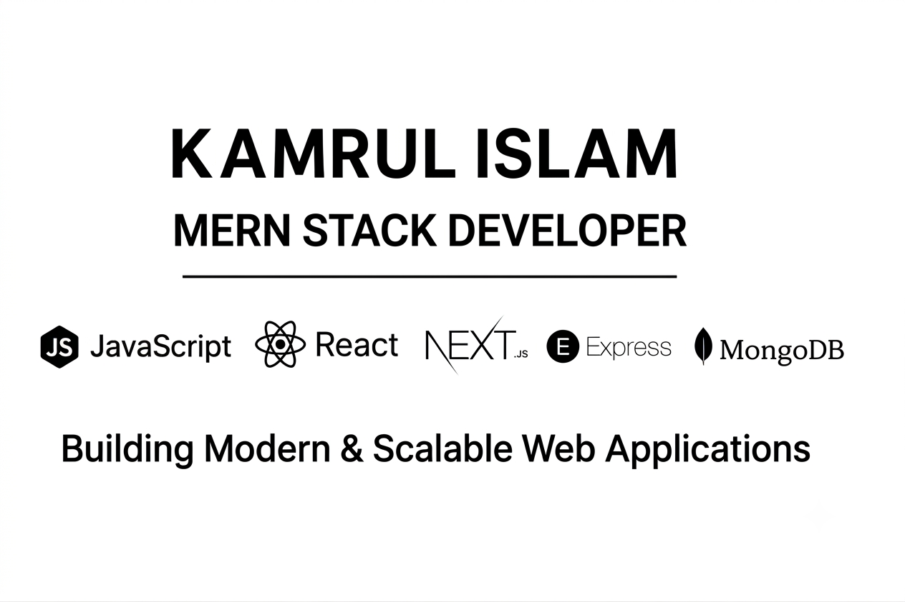

  

<!-- Banner -->

  

<h1 align="center">Hi 👋, I'm Kamrul Islam</h1>

<h3 align="center">
Junior Full-Stack Developer | Next.js 16 • React 19 • TypeScript • WebRTC • PostgreSQL • Prisma • Docker • Node.js
</h3>

  <strong>🚀 Web Developer Intern at GOBAADI • Open to Full-Stack / Next.js / Frontend Roles</strong>

I engineer responsive, accessible, and high-performance web applications using Next.js 16, React 19, TypeScript, WebRTC, WebSockets, PostgreSQL, Prisma ORM, Docker, and Node.js. Passionate about continuous learning, real-time media streaming, clean architecture, secure authentication, and building seamless user experiences.

---

# 🚀 Connect With Me

🌐 **Portfolio:** https://my-portfolio-theta-rose-11.vercel.app/  
📫 **Email:** kamrulislam25262800@gmail.com  
💼 **LinkedIn:** https://www.linkedin.com/in/kamrul397/  
💬 **WhatsApp:** https://wa.me/8801894565173  

---

# 👨‍💻 About Me

- 💻 **Junior Full-Stack Developer** & Web Developer Intern at **GOBAADI**
- 📚 Passionate about **continuous learning** and rapidly adapting to modern engineering tools
- 🧾 Built **SmartReceipt AI** – a full-stack expense tracking platform with Next.js 16, Google Gemini Vision OCR, split-screen reconciliation, document guardrails, and PostgreSQL via Prisma ORM
- 🎓 Built **LiveClass** – a zero-dependency virtual classroom with pure native WebRTC (P2P mesh for 4–5 participants), WebSockets, screen sharing with `replaceTrack`, and a shared HTML5 canvas whiteboard
- 💼 Built **CareerConnect** – a full-stack job recruitment portal with Next.js 16, faceted search via MongoDB aggregation pipelines, and Cloudinary PDF processing
- 🛠️ Deep experience modeling relational schemas with **PostgreSQL & Prisma ORM** alongside NoSQL **MongoDB Atlas & Mongoose**
- 🐳 Proficient in **Docker & Docker Compose** for containerizing full-stack multi-service applications
- ⚡ Skilled in **TanStack Query v5** for optimistic UI updates, background caching, and zero-latency state synchronization
- 🔐 Strong focus on **Role-Based Access Control (RBAC)** and secure **HTTP-Only JWT Cookie** authentication
- 🎯 Goal: Continuously learn, write type-safe code, and build impactful digital products with collaborative teams

---

# 🔨 Tech Stack

### Languages & Frontend

  

### Backend & Databases

  

### DevOps & Tools

  

---

# 🌟 Featured Projects

## 🚀 SmartReceipt AI – Multimodal Financial Document Parser & Expense Tracker

Full-stack AI-powered expense tracking and receipt auditing platform. Extracts store details, dates, taxes, and itemized line items from receipt images or PDFs using Google Gemini Vision. Features a split-screen review interface, non-receipt guardrails, instant PDF voucher downloads for guests, member dashboard with monthly spending charts, and 1-click CSV/PDF export.

**Tech Stack**
- Next.js 16 (App Router) & React 19
- TypeScript (Strict Mode)
- Google Gemini Flash API (Multimodal OCR)
- PostgreSQL (Neon Serverless) & Prisma 7
- Zod & Tailwind CSS v4
- Custom JWT Authentication (HTTP-Only Cookie)

🔗 **Live Demo:** https://smart-receipt-ai.vercel.app  
🔗 **Repository:** https://github.com/kamrul397/smart-receipt-ai  

---

## 🚀 LiveClass – Zero-Dependency WebRTC Virtual Classroom & P2P Collaboration

Lightweight, high-performance virtual classroom platform built with pure native WebRTC and WebSockets without third-party SDKs (no Agora or LiveKit). Enables direct peer-to-peer audio and video calling for 4–5 participants with Google STUN, dynamic auto-resizing video grid layout, lobby waiting room with host moderation (remote mute & participant kick), seamless mid-call screen sharing via `replaceTrack`, in-call P2P text chat with "Raise Hand" alerts, synchronized shared HTML5 canvas whiteboard, and real-time connection quality/RTT telemetry.

**Tech Stack**
- Native WebRTC API (MediaStream & DataChannels)
- WebSockets (`ws`) & Node.js
- HTML5 Canvas API (Peer-to-Peer Draw Sync)
- Vanilla JavaScript (ES6+) & Modern CSS3
- STUN Server Configuration (NAT Traversal)

🔗 **Live Demo:** https://liveclass-webrtc.onrender.com/  
🔗 **Repository:** https://github.com/kamrul397/liveclass-webrtc  

---

## 🚀 CareerConnect – Full-Stack Job Search & Recruitment Portal

Full-stack job search and recruitment portal connecting candidates, recruiters, and administrators. Features role-protected workspaces, faceted job filtering powered by MongoDB multi-stage aggregation pipelines, automated Cloudinary PDF resume parsing, and TanStack Query v5 background caching.

**Tech Stack**
- Next.js 16 (App Router) & React 19
- TypeScript & JavaScript (ES6+)
- Node.js & Express.js
- MongoDB Atlas & Mongoose
- TanStack Query v5
- Firebase Auth & HTTP-Only JWT
- Cloudinary API
- Tailwind CSS

🔗 **Live Demo:** https://career-connect-iota-pied.vercel.app  
🔗 **Repository:** https://github.com/kamrul397/careerConnect  

---

# 📊 GitHub Stats

  

  

  

---

# 📌 Pinned Repositories

- ⭐ [SmartReceipt AI](https://github.com/kamrul397/smart-receipt-ai) — Multimodal Expense Tracker & Receipt Parser with Gemini Vision, Prisma & PostgreSQL
- ⭐ [LiveClass](https://github.com/kamrul397/liveclass-webrtc) — Zero-Dependency Virtual Classroom with Native WebRTC (4–5 Peers) & WebSockets
- ⭐ [CareerConnect](https://github.com/kamrul397/careerConnect) — Multi-Role Job Search & Recruitment Portal
- ⭐ [Portfolio](https://github.com/kamrul397/my_portfolio) — Interactive Full-Stack Developer Portfolio

---

  Thanks for visiting my profile ❤️

